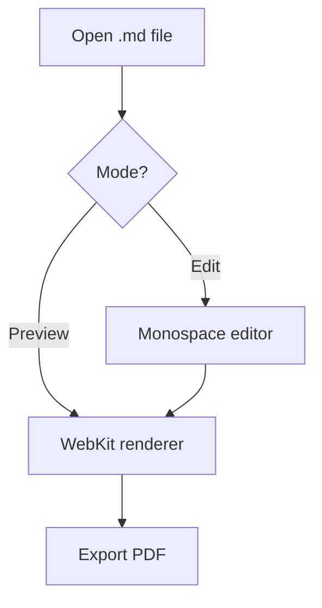
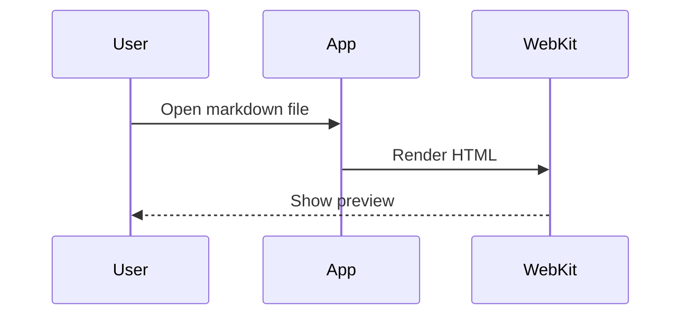

# Sample Markdown

This is a **simple** Markdown viewer with *edit* and *preview* modes.

Setext Header 1
===============

Setext Header 2
---------------

## Features

- Open existing `.md` files
- Edit with a monospace source editor
- Preview with a WebKit renderer
- Render Mermaid diagrams
- Autosave after 1 second of inactivity
- Export the rendered preview to PDF
- ~~Scratch that~~

## Tasks

- [x] Build basic editor
- [ ] Add preview mode
- [ ] Add syntax highlighting

## Code Example

Inline code looks like `print("hello")`.

```swift
import SwiftUI

struct ContentView: View {
    var body: some View {
        Text("Hello, Markdown!")
    }
}
```

## Mermaid Diagrams

Fenced code blocks tagged `mermaid` are rendered as diagrams.





## Lists & Links

Nested lists are supported:

- Top level item
  - Nested item
    - Even deeper
  - Another nested item
- Back to top level

1. First
2. Second
   1. Nested ordered item
   2. Another one
3. Third

Task nesting works too:

- [x] Ship markdown viewer
- [x] Add syntax highlighting
  - [x] Bundle highlight.js
  - [ ] Add editor highlighting

Bare URLs autolink: https://swift.org and https://github.com.

## Math

Inline LaTeX like $\rightarrow$ and $E = mc^2$ renders with KaTeX.

Block math:

$$\sum_{i=1}^{n} x_i = \frac{n(n+1)}{2}$$

Escaped dollars stay literal: \$5 and \$10.

> This is a blockquote with a **bold** statement.

---

Line break test  
This should be on a new line.

[OpenAI](https://openai.com)

## Table Example

| Feature | Status | Priority |
|:--------|:------:|---------:|
| Edit    | Done   | High     |
| Preview | Done   | High     |
| Tables  | Done   | Medium   |
